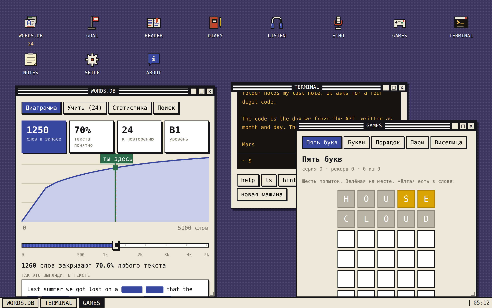
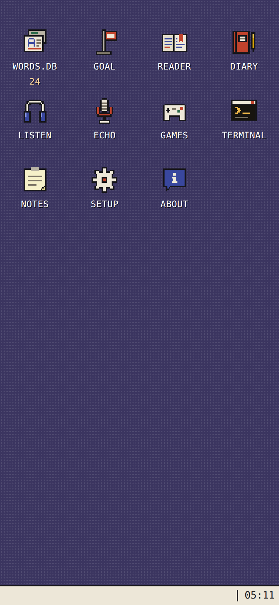
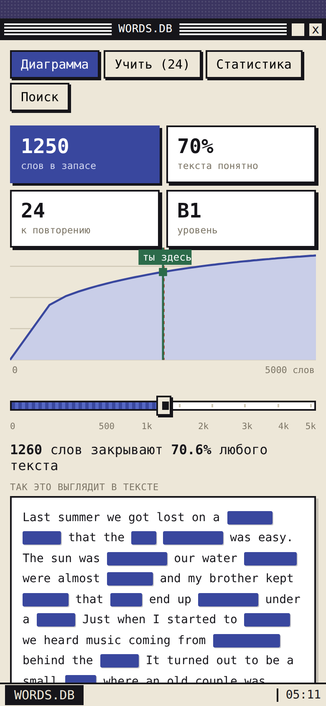
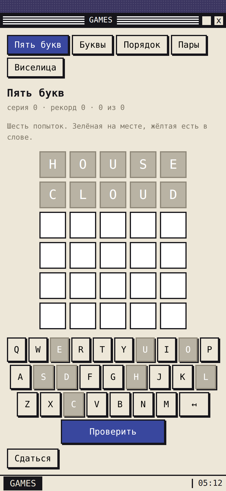
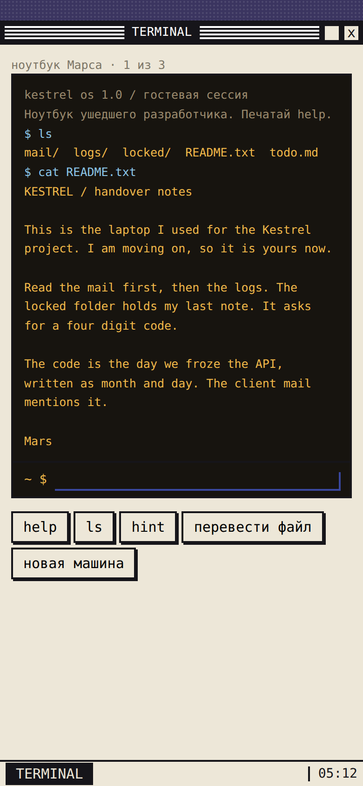

<div align="center">


# WordOS

**Learn English inside a tiny pixel-art desktop OS.**
Vocabulary with spaced repetition, LLM-written texts and cards, word games, dictation and a
text adventure — each one a window on your phone's desktop.

[](https://github.com/mirendex/wordos/actions/workflows/build-apk.yml)
[](https://github.com/mirendex/wordos/releases/latest)
[](LICENSE)


**English** · [Русский](README.ru.md)



<table>
  <tr>
    <td></td>
    <td></td>
    <td></td>
    <td></td>
  </tr>
</table>

</div>

## About

WordOS is an Android app for learning English on your own material. Instead of a feed of
lessons, it is a small desktop operating system running in a single WebView: apps are icons,
everything opens in windows you can drag, resize, maximize and minimize to the taskbar, and all
of them share one vocabulary, so progress in any app counts everywhere.

- The interface is in **Russian** — the app is made for Russian speakers learning English. Code,
  comments and docs are in English.
- Texts, cards, dialogues and checks are written by an LLM through
  [OpenRouter](https://openrouter.ai/) with **your own API key**; pick any model you like.
- No account, no backend: everything is stored on the device.

## Features

| App          | What it does                                                                                                                           |
| ------------ | -------------------------------------------------------------------------------------------------------------------------------------- |
| **WORDS.DB** | The 5000 most frequent English words with spaced repetition (SRS) and generated cards: example sentence, translation, word forms.      |
| **GOAL**     | Prepare for an event by a date — a trip, an interview, a move: scenario vocabulary and phrases, a daily quota and role-play dialogues. |
| **READER**   | Texts on a chosen topic at your level (CEFR), streamed as they are written, with tap-to-translate for any word.                        |
| **DIARY**    | Write in English and get your text checked, corrected and explained.                                                                   |
| **LISTEN**   | Listening dictation with text-to-speech.                                                                                               |
| **ECHO**     | Read-aloud practice scored with speech recognition.                                                                                    |
| **GAMES**    | Five-letter word game, word search, sentence order, pairs and hangman.                                                                 |
| **TERMINAL** | A text adventure: explore a departed developer's laptop with `ls`, `cd` and `cat` to find the code.                                    |
| **NOTES**    | Your saved words and the corrections collected from the diary.                                                                         |
| **SETUP**    | OpenRouter key and model, voice, haptics strength and daily review reminders.                                                          |

**Under the hood**

- A small window manager: drag, resize from the corner, maximize/restore, minimize to the
  taskbar, marquee selection — with mouse and touch; on phones (≤ 760 px) windows go fullscreen.
  Windows come back where you left them.
- Android's predictive back gesture animates the top window closed (custom `BackGate` plugin).
- A launch animation that continues the system splash frame-for-frame.
- Haptics with real amplitude control on supported phones (custom `Vibe` plugin), TTS/STT and
  local reminders.
- The model is asked ahead in the background — the next cards, scenes, dictation phrases and
  terminal machines — so most screens open instantly.

## Install

1. Download `wordos-<version>.apk` from the [latest release](https://github.com/mirendex/wordos/releases/latest)
   and install it (allow installing from unknown sources if asked).
2. Get an API key at [openrouter.ai/keys](https://openrouter.ai/keys).
3. Open **SETUP** in the app, paste the key and choose a model.

## Development

**Requirements:** Node.js 22+; for the APK also JDK 21 and the Android SDK.

```bash
git clone https://github.com/mirendex/wordos.git
cd wordos
npm install
npm run dev
```

| Command                  | What it does                                                |
| ------------------------ | ----------------------------------------------------------- |
| `npm run dev`            | Dev server with hot reload                                  |
| `npm run build`          | Typecheck and build the web part into `www/`                |
| `npm run typecheck`      | TypeScript in strict mode                                   |
| `npm run lint`           | ESLint                                                      |
| `npm run format`         | Prettier                                                    |
| `npm test`               | Vitest unit tests                                           |
| `node scripts/smoke.mjs` | End-to-end run in headless Chromium (after `npm run build`) |
| `npm run screenshots`    | Regenerate the README screenshots into `docs/screenshots/`  |
| `npm run icons`          | Regenerate launcher icons, splash and boot logo             |

### Building the APK

```bash
npm run copy   # build the web part and sync it into android/
npm run open   # open the project in Android Studio
npm run apk    # build a debug APK with Gradle
```

### CI and releases

[`build-apk.yml`](.github/workflows/build-apk.yml) runs on every push to `master`: lint,
typecheck and tests, then the web build and a signed release APK, uploaded as a workflow
artifact. Signing uses the repository secrets `ANDROID_KEYSTORE_BASE64` (a base64-encoded
keystore) and `ANDROID_KEYSTORE_PASSWORD`; the key alias must be `wordos` (see
`android/app/build.gradle`). The signing and release steps run only in the upstream repository,
so forks still get lint, tests and the web build. The smoke run takes about two minutes and is
run by hand.

### Releasing a new version

The version lives in one place, `package.json`; Android's `versionName` and `versionCode` are
derived from it (`1.4.0` → `10400`). A release is published only when the version changes:

```bash
npm version minor --no-git-tag-version   # or patch / major
git commit -am "Release 1.5.0"
git push
```

When CI sees a version with no `v<version>` tag yet, it creates the tag and a
[GitHub release](https://github.com/mirendex/wordos/releases) `WordOS <version>` with
`wordos-<version>.apk` and notes generated from the commits. Pushes without a version change only
build the APK.

## Architecture

Framework-free TypeScript: rendering is template strings, with no virtual DOM. `paint()`
redraws the desktop and windows on every state change. The circular "everything calls paint,
paint calls everything" dependency is broken by `core/paint.ts`, which knows nothing about the
screens and only holds the current render function (`setPainter`) that `ui/render.ts` supplies
at startup. Pure logic lives in `src/lib/` and is what the unit tests cover.

<details>
<summary>Project structure</summary>

```
index.html               entry point, desktop markup
src/
  main.ts                bootstrap: gestures, keyboard, clicks, load() → boot()
  env.d.ts               global declarations (window.storage, *.txt?raw)
  styles/                CSS, split by interface section
  lib/                   pure functions, covered by tests: json.ts (parsing cut-off JSON from
                         the LLM), scale.ts (level scale, CEFR), text.ts (Levenshtein distance,
                         answer checking, diff), five.ts, termfs.ts (quest filesystem),
                         grid.ts (word search layout), srs.ts (spaced-repetition ladder),
                         plan.ts (countdown, daily quota, goal progress)
  data/                  frequency dictionary (freq.txt, 5000 words)
  core/                  persist.ts (state, card bank, load/save), paint.ts, storage.ts
                         (localStorage shim), util.ts, keys.ts
  platform/              Capacitor wrappers: haptics.ts, speech.ts (TTS/STT), appinfo.ts,
                         notify.ts
  services/              llm.ts (OpenRouter), models.ts, translate.ts, warm.ts (background
                         prefetch)
  domain/                frequency.ts, vocab.ts, progress.ts, cards.ts, goal.ts
  ui/                    windows.ts (window manager + back gesture), render.ts (paint + screen
                         router), icons.ts, modal.ts, gestures.ts, keyboard.ts, actions.ts,
                         deal.ts (card-dealing loader), bootanim.ts + bootlogo.ts (launch
                         animation; bootlogo.ts is generated)
  apps/                  one module per app: about, reader, notes, setup, diary/, echo/,
                         listen/, terminal/, vocab/, goal/, games/
scripts/
  smoke.mjs              headless run of every window, game, persistence and window management
  screenshots.mjs        README screenshots
  gen-icons.mjs          icons, splash and boot logo from one pixel map
android/                 native Android project (Capacitor)
  app/src/main/java/dev/mirendex/diffen/
    MainActivity.java    registers the plugins, hands the splash over to the web part
    BackGatePlugin.java  predictive back gesture, in sync with the window state in JS
    SplashGatePlugin.java  lets the web part say when the splash can go
    VibePlugin.java      haptic pulses with their own amplitude
```

</details>

## Privacy

Progress, cards and settings — including your API key — are kept in the app's local storage
and never leave the device, except for these requests:

- [OpenRouter](https://openrouter.ai/) — prompts for texts, cards, checks and dialogues, sent
  with your key;
- [MyMemory](https://mymemory.translated.net/) — free translation of single words (READER, word search, games);
- Google Fonts — the interface fonts.

## License

[MIT](LICENSE) © mirendex
